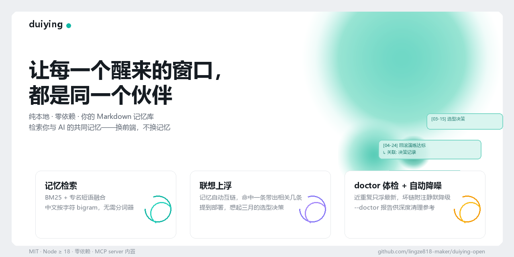
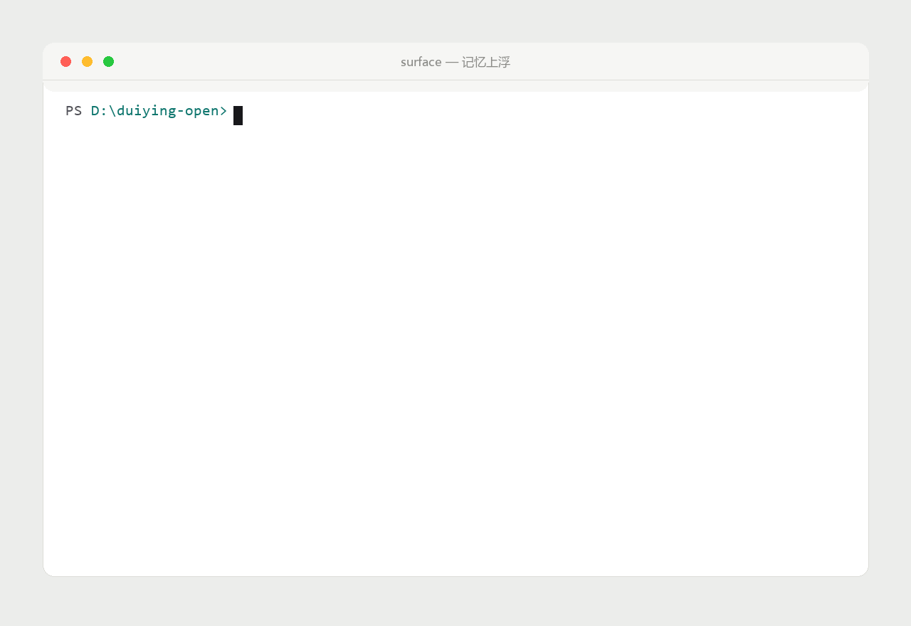

# 对影 · 人机搭档记忆库（开源版）

简体中文 · **English** ([README.en.md](README.en.md))

<p align="center">
  


> **让每一个醒来的窗口，都是同一个伙伴。**
>
> 纯本地，几乎无上传带来的隐私泄露；通用构件，可用于大多数前端。

大多数人和 AI 的日常，是**搭档**：一起做项目、记决策、续上下文。
而几乎所有 AI 前端都患同一种健忘——上周拍过的板，这周重新吵一遍。

对影把"记忆"做成**检索问题**而非存储问题：扫描你的 Markdown 记忆库，
把"可能相关的记忆"以**路标**的形式（一行一条）浮上来，交给任意 AI 前端注入对话。

**为什么不是又一个记忆系统？因为记忆不该被锁定。**
许多记忆方案把记忆放进它们的云端，或锁进它们自己的框架——
前端内置的记忆换一家就丢。对影的记忆是**你的 Markdown 文件**：
开放格式、存在你的磁盘、任何前端（zcode / codex / deepseek harness /
自建 UI）都只是读者。前端可以换、可以死，记忆一直在。

## 它凭什么不同

| 能力 | 说明 |
|---|---|
| **BM25 + 专名短语融合** | 中文按字符 bigram 无需分词器；关键词整串命中单独计强分 |
| **时间先验** | 最近的记忆自然更容易想起；查询含"最近/上周/去年"自动切时间优先模式 |
| **联想上浮（浮一带二）** | 记忆自动互链，命中一条带出相关几条——"提到部署，想起三月的选型决策" |
| **取代而非删除** | 事实变了？旧条目标 `superseded_by` 降权保留，上浮时自带"已被取代"附注 |
| **沉默列表** | `suppress` / `suppress_when`——有些记忆不该被提起，但**浮不上来 ≠ 删掉** |
| **路标式注入** | 一行一条线索不灌全文——同样 token 预算能容纳更多条记忆 |
| **不背档案** | 结果自带"除非对方问起，不要主动罗列"的措辞——记忆应在言谈中自然流露 |
| **doctor 体检 + 自动降噪** | 检索时自动应用安全修正（近重复只浮最新、坏链附注静默降级）；`--doctor` 报告供深度清理参考 |

**没有向量数据库，没有图数据库，没有本地小模型，没有 API key。**
Node 18 以上就能跑。

> **规模边界（诚实声明）**：引擎为**个人记忆库（数十至数千篇 Markdown）**设计，
> 每次查询全量扫描并计算联想链。千篇级毫秒到秒级；更大的语料需要增量索引，
> 那不在"个人记忆"的定位里。

## 快速开始

> **已经有现成的 Markdown 笔记？** 不需要任何转换——
> [把目录直接指给引擎](docs/连接现有记忆库.md)，立刻可检索。

```bash
git clone https://github.com/lingze818-maker/duiying-open.git
cd duiying-open

# 用示例语料（完全虚构的"AI 项目搭档小临"三个月记忆）跑一发
node engine/surface.mjs "部署,回滚" --root examples/partner-xiaolin --detail
```

输出长这样：

```
- [2026-03-15] 项目决策记录 —— 决策记录.md (s9)
  ↳ 关联: 会议纪要.md
  ↳ 此条已被取代，见 新方案.md        ← 仅当条目标记了 superseded_by
  > 部署用 Docker Compose 单机版，回滚流程：先停服务 → 还原数据库快照…
```

<p align="center">
  
</p>

程序化消费（任意前端接入点）：

```bash
node engine/surface.mjs "部署" --root ./我的记忆库 --json
```

```json
{
  "engine": "duiying-open/0.2",
  "query": ["部署"],
  "hint": "除非对方问起或自然相关，不要主动罗列这些记忆。",
  "results": [
    { "path": "决策记录.md", "title": "项目决策记录", "date": "2026-04-01",
      "score": 12.3, "links": ["会议纪要.md"], "note": "此条已被取代，见 新方案.md" }
  ]
}
```

把 `results` 作为附加线索拼进你 AI 的 system prompt，记忆就有了。

## 前端接入

详见 [docs/接入契约.md](docs/接入契约.md)。四条路任选：

- **CLI 直调**（zcode / codex / deepseek harness 等 agent 环境）：工具定义里包一层 `node engine/surface.mjs "$query" --root <库> --json`；
- **MCP server**（zcode / claude 系 / 任何 MCP 宿主）：`node mcp/server.mjs` 起 stdio 服务，宿主配置一行获得 `memory_surface` / `memory_doctor` 工具；
- **Node 程序内嵌**：`import { tokenize, buildStats, bm25, buildLinks, spread } from "./engine/lib.mjs"`——纯函数无 IO，怎么编排都行；
- **记忆条目状态**：在 md 头部写 frontmatter 即生效——

```markdown
---
superseded_by: 新方案.md      # ⑥ 取代：降权保留 + 附注指向
suppress: true                # ⑦ 整篇沉默（文件原样保留）
suppress_when: [关键词A, B]   # ⑦ 条件沉默：查询含这些词时不浮
---
```

## 记忆库怎么长

不需要任何格式迁移——**就是一堆 Markdown 文件**。建议的松散约定：

- 文件名即语义（`决策记录.md`、`会议纪要-2026-04.md`）
- 首行 `# 标题` 会成为路标
- 需要状态控制时才加 frontmatter

定期跑一次体检：

```bash
node engine/surface.mjs --doctor --root ./我的记忆库
```

## 哲学

**只浮线索，不替记忆。**

检索结果不改写、不删除、不裁决任何记忆。近年头部记忆系统不约而同
收敛到同一条原则：**记忆原文神圣，智能放在检索层**。对影从第一天就
长在这里。

为什么检索层值得认真做？因为"它真的记得我"从来不是存储问题——
是**想起来的方式**问题：联想、时效、分寸（什么场合想起什么）。
这八件事全是纯算法，这整个仓库没有任何模型依赖。

## 文档

- [前端接入契约](docs/接入契约.md)
- [示例语料说明](examples/partner-xiaolin/README.md)

## 路线图

- [x] v0.2 批一：BM25 融合 / 时间先验 / 联想扩散 / 路标注入 / 措辞
- [x] v0.2 批二：取代标记 / 沉默列表 / doctor 体检
- [ ] 批三（评估中）：闲时 LLM 提炼候选记忆（人工确认入库）/ 稳定档案层
- [x] 真机演示 GIF

## License

MIT
